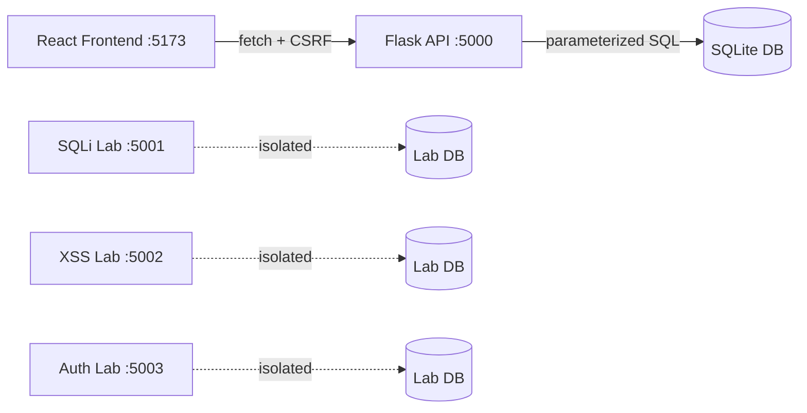

# SecureGate

A full-stack student portal built to demonstrate both sides of web
application security: how common vulnerabilities work, and how to prevent
them, with hands-on exploitation, manual and automated testing, and
professional-style security documentation.

[](https://github.com/sadhana-08/securegate/actions/workflows/tests.yml)

> ⚠️ **This repository includes intentionally vulnerable code for
> educational purposes.** The vulnerable labs under
> `security/vulnerability-labs/` are isolated, local-only applications
> gated behind an explicit environment variable and a localhost-only bind
> check. **Never deploy any part of `security/vulnerability-labs/` to a
> public network.**

---

## Overview

SecureGate is a React + Flask student portal (registration, login,
dashboard, profile management) built the way a real production
application would be: parameterized queries, hashed passwords, CSRF
protection, security headers, and session hardening.

Alongside it are three small, isolated, intentionally broken applications
that demonstrate exactly how **SQL Injection**, **Cross-Site Scripting**,
and **Broken Authentication / Session Management** actually work, followed
by hands-on Burp Suite testing and an automated Pytest regression suite
proving the real application resists each attack.

## Architecture



The secure application and the three vulnerability labs share no code and
run on separate ports. The labs are gated behind a `SECUREGATE_LAB=1`
environment variable and refuse to bind to anything but `127.0.0.1`.

## Features

- Student registration, login, and logout
- Session-based authentication with secure, HttpOnly cookies
- Protected dashboard and profile pages
- Profile viewing and editing with server-side authorization
- CSRF protection on all state-changing requests
- Security headers (CSP, X-Frame-Options, X-Content-Type-Options, etc.)
- Login rate limiting and generic authentication errors
- Responsive, light, blue/navy themed UI

## Technology Stack

| Layer | Technology |
|---|---|
| Frontend | React, Vite, JavaScript, CSS |
| Backend | Python, Flask, REST API |
| Database | SQLite |
| Security testing | Burp Suite Community Edition, OWASP methodology, Pytest |
| CI | GitHub Actions |

## Project Structure
securegate/
├── frontend/ # React + Vite app
├── backend/ # Flask API, tests, database
├── security/
│ ├── vulnerability-labs/ # Isolated, intentionally vulnerable apps
│ │ ├── sqli/ sqli-lab/
│ │ ├── xss/ xss-lab/
│ │ └── broken-auth/ auth-lab/
│ ├── reports/ # Assessment reports, evidence screenshots
│ └── test-cases/ # Burp Suite test case table
├── docs/ # Threat model, testing methodology
├── .github/workflows/ # CI test automation
└── README.md

## Installation

**Prerequisites:** Python 3.11+, Node.js (LTS), Git.

```bash
git clone https://github.com/YOUR-USERNAME/securegate.git
cd securegate
```

## Setup and Run (Git Bash, Windows)

**Backend:**

```bash
python -m venv .venv
source .venv/Scripts/activate
python -m pip install -r backend/requirements.txt
cp .env.example .env   # then set a real SECRET_KEY inside .env
python backend/init_db.py
export SEED_PASSWORD='YourThrowawayPass123!'
python backend/seed.py
python backend/run.py
```

Backend runs at `http://127.0.0.1:5000`.

**Frontend** (in a second terminal):

```bash
cd frontend
npm install
npm run dev -- --host 127.0.0.1 --port 5173 --strictPort
```

Open `http://127.0.0.1:5173` in your browser.

## Running the Vulnerability Labs

Each lab is fully isolated, with its own virtual environment and database:

```bash
cd security/vulnerability-labs/sqli-lab   # or xss-lab / auth-lab
python -m venv .venv
source .venv/Scripts/activate
python -m pip install -r requirements.txt
export SECUREGATE_LAB=1
python app.py
```

See each lab's paired write-up (`security/vulnerability-labs/sqli/README.md`,
`xss/README.md`, `broken-auth/README.md`) for exact payloads and expected
results.

## Automated Security Tests

```bash
source .venv/Scripts/activate
python -m pip install -r backend/requirements-test.txt
PYTHONPATH=backend python -m pytest backend/tests -q
```

This runs 17 automated checks covering SQL injection resistance, XSS
handling, CSRF enforcement, authorization, session security, rate
limiting, and more. The same suite runs automatically on every push via
GitHub Actions.

## Security Testing with Burp Suite

See `docs/burp-suite-workflow.md` for the full manual testing workflow:
proxy setup, request interception, Repeater-based payload testing, and
retesting the secure app after each lab. Evidence screenshots are in
`security/reports/evidence/`.

## Vulnerabilities Demonstrated & Remediated

| Vulnerability | Demonstrated in | Fixed in |
|---|---|---|
| SQL Injection (auth bypass, UNION extraction) | `security/vulnerability-labs/sqli-lab` | `backend/app/auth.py`, `db.py` |
| Reflected & Stored XSS | `security/vulnerability-labs/xss-lab` | React output encoding, `frontend/src` |
| Plaintext passwords, predictable sessions, insecure cookies, no rate limiting, user enumeration | `security/vulnerability-labs/auth-lab` | `backend/app/auth.py`, `__init__.py` |

Full details: `security/reports/vulnerability-comparison-table.md`,
`security/reports/remediation.md`, and the sample assessment report at
`security/reports/sample-assessment-report.md`.

## Documentation

- [Threat Model](docs/threat-model.md)
- [Testing Methodology](docs/testing-methodology.md)
- [Burp Suite Workflow](docs/burp-suite-workflow.md)
- [Vulnerability Comparison Table](security/reports/vulnerability-comparison-table.md)
- [Remediation Documentation](security/reports/remediation.md)
- [Sample Assessment Report](security/reports/sample-assessment-report.md)

## Screenshots

_Add screenshots here: dashboard, profile page, and a Burp Suite
before/after comparison._

- `docs/screenshots/dashboard.png`
- `docs/screenshots/profile.png`
- `docs/screenshots/burp-sqli-comparison.png`

## Future Enhancements

- Multi-factor authentication
- Audit logging / non-repudiation
- HTTPS enforcement and production WSGI server
- Dependency vulnerability scanning in CI
- Expanded OWASP Top 10 coverage (e.g. SSRF, insecure deserialization)

## License

MIT — see [LICENSE](LICENSE).

## Security

See [SECURITY.md](SECURITY.md) for responsible disclosure guidance.

---

**This project was built in 12 phases as a structured learning exercise,
each phase committed and tagged individually (`v0.1-setup` through
`v1.0.0`). See the repository's tags for the full build history.**